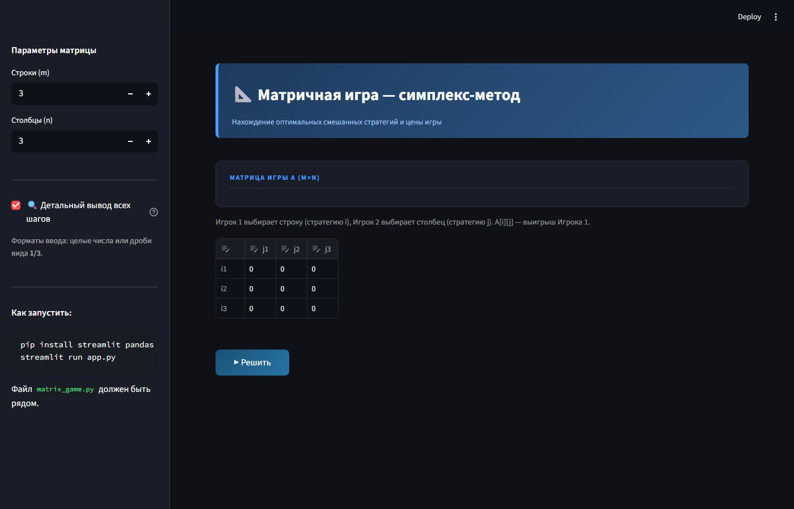
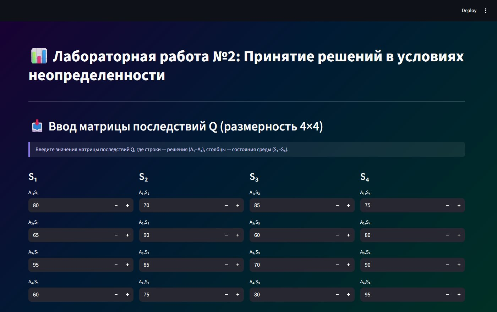

# Game Theory Labs

Lab work from the **Game Theory** course (3rd year, semester 6) at Don State Technical University (DSTU).
Both labs are interactive **Streamlit** apps that solve the problem and show every intermediate step, so they can be used to check calculations by hand. The interface is in Russian.

## 1. Matrix game solver (simplex method)

Finds the optimal mixed strategies of both players and the value of a two-player zero-sum game given by an m×n payoff matrix.



**Algorithm**

1. Search for a **saddle point**: if one exists, the game has a pure-strategy solution.
2. Remove **dominated strategies** to shrink the matrix.
3. Shift the matrix to make all payoffs positive and reduce the game to a pair of dual **linear programming** problems.
4. Solve them with the **primal and dual simplex method** using exact fractions (`fractions.Fraction`), with every simplex tableau and pivot highlighted in the UI.
5. Recover the mixed strategies of both players and the game value.

| File | Description |
|---|---|
| `matrix-game-simplex/app.py` | Streamlit interface: matrix input, step-by-step tableaux |
| `matrix-game-simplex/matrix_game.py` | Solver: saddle point, dominance, primal/dual simplex |
| `matrix-game-simplex/main.py` | Console entry point |
| `matrix-game-simplex/versions/` | First version of the solver |

## 2. Decision making under uncertainty

Chooses the best decision A₁–A₄ for a consequence matrix Q (decisions × states of nature S₁–S₄) using the classic criteria.



| Criterion | Idea |
|---|---|
| Risk matrix R | Regret of each decision relative to the best one in every state |
| Wald (maximin) | Best worst-case outcome |
| Savage (minimax regret) | Smallest maximum regret |
| Hurwicz | Weighted mix of the best and worst outcome: λ·max + (1 − λ)·min, where λ is the optimism coefficient |
| Expected value (MQ) | Highest expected outcome for given state probabilities |
| Expected regret (MR) | Smallest expected regret |

A "show detailed calculations" switch displays the formulas and arithmetic for every row and column.

| File | Description |
|---|---|
| `decision-under-uncertainty/app.py` | Final version of the app |
| `decision-under-uncertainty/versions/` | Intermediate iterations of the same lab |

## How to run

```bash
pip install -r requirements.txt

cd matrix-game-simplex
streamlit run app.py        # or: python main.py

cd ../decision-under-uncertainty
streamlit run app.py
```

## Tech stack

Python · Streamlit · pandas · NumPy · exact rational arithmetic (`fractions`)

## License

[MIT](LICENSE)
